# 如何利用WinDbg分析蓝屏崩溃

## PART 1 概述

WinDbg 是微软官方推出的一款**Windows 调试工具**

主要用于调试内核模式和用户模式的代码 也常用于分析系统或应用程序崩溃时生成的转储文件

这篇文章讲的就是用它分析电脑蓝屏产生的转储文件

## PART 2 使用对象

### PART 2.1 蓝屏转储文件的由来

先讲讲为什么会蓝屏

蓝屏本质上是Windows的一种自我保护机制

系统遇到无法安全恢复的严重错误时 系统选择主动停机 而不是带着未知错误继续运行

> 人话就是你的系统已经被搅坏了 强行接着运行可能会搅得更糟糕 于是选择主动停机

遇到错误时 系统会调用内核函数`KeBugCheckEx`

冻结当前的状态 不再调度新任务 显示蓝屏 并在屏幕上给出停止代码和可能的原因

比如下图


程序会把内存中的关键信息写入转储文件 供后续分析

常见的蓝屏转储文件格式为`.dmp` 即DUMP文件 也就是我们要分析的对象

“启动和恢复”设置里 可以选择不同的转储级别 这决定了 DUMP文件的大小和内容

分为 小内存转储、核心内存转储、完整内存转储、自动内存转储

### PART 2.2 小内存转储

顾名思义就是很小的内存转储文件 只有256KB左右 只保存最核心的线索

默认存放在 `C:\Windows\Minidump`文件夹下

包含：

- 蓝屏代码（Bug Check Code）

- 四个参数（没有全局统一的固定含义 具体含义由当前的蓝屏代码界定）

- 崩溃那一刻的调用栈

- 已加载的驱动程序列表

### PART 2.3 核心内存转储

保存内核模式使用的所有内存 大小中等且不固定 通常约为物理内存的1/3

默认保存至`C:\Windows\MEMORY.DMP`

除了小内存转储的内容 它还包含：

- 操作系统内核

- 硬件抽象层

- 所有加载的内核驱动

- 崩溃时所有内核线程的调用栈

不包含用户模式程序的数据

### PART 2.4 完整内存转储

顾名思义就是把完整的物理内存全刻进硬盘 32G就刻32G 64G就刻64G

默认保存位置也在`C:\Windows\MEMORY.DMP`

包含了所有通过内存可以查到的内容 不过因为文件太大 开这个模式的比较少

### PART 2.5 自动内存转储

Win7 之后引入的“智能”选项 系统会自动判断选用哪种转储方式 通常生成的是核心内存转储

也就是说 自动内存转储并不是一个单独的转储方式 只是一个决策工具

大部分用户开的都是这个

## PART 3 使用方法&例题

安装完WinDbg后 双击dmp文件即可自动进入WinDbg界面

初次打开会安装很多内容 主要是符号文件

可以理解成蓝屏转储文件的说明书 等它装完才能正常使用

光看说明书是很难搞的 直接上手一下

这里以 [SUSCTF2026]Silent Crash 的dmp文件为例 共8道题

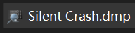

### PART 3.1 请提交本次崩溃的 BugCheck Code

双击打开

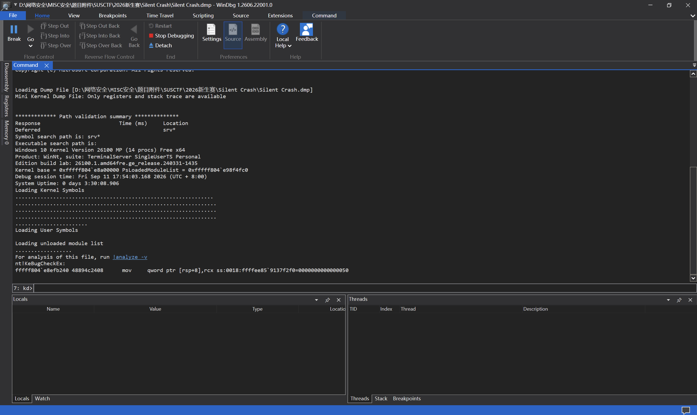

我们发现它输出了一堆英文和一个高亮的`!analyze -v`
这些英文是WinDbg的初始化和加载日志 和文件本体没多大关系 忽略即可

`!analyze -v` 是WinDbg的一个命令 作用是自动对蓝屏文件进行分析与研判

单击高亮文本即可自动执行

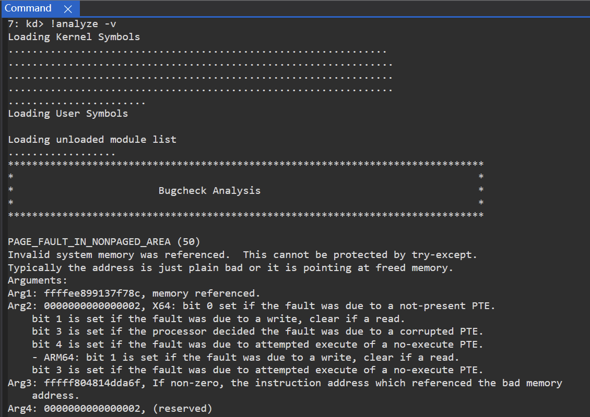

可以看到它对蓝屏的错误进行了分析 给出了错误代码以及四个参数

并且四个参数的含义还贴心地做了释义

题目要求提交本次崩溃的BugCheck Code

直接信息就是 `PAGE_FAULT_IN_NONPAGED_AREA (50)`

可以看到蓝屏代码的数值为`50`

`PAGE_FAULT_IN_NONPAGED_AREA`是`50`的释义名字

而BugCheck Code是要数值 也就是`50`

所以这道题的答案是`50`

### PART 3.2 被异常访问的内存地址以及访问类型是什么？

我们接着细看提供的四个参数的含义

> 注意这里的参数含义只适用于当前的BugCheck Code
>
> 若BugCheck Code不同 参数的含义也会不同

```
Arg1: ffffee899137f78c, memory referenced.
Arg2: 0000000000000002, X64: bit 0 set if the fault was due to a not-present PTE.
        bit 1 is set if the fault was due to a write, clear if a read.
        bit 3 is set if the processor decided the fault was due to a corrupted PTE.
        bit 4 is set if the fault was due to attempted execute of a no-execute PTE.
        - ARM64: bit 1 is set if the fault was due to a write, clear if a read.
        bit 3 is set if the fault was due to attempted execute of a no-execute PTE.
Arg3: fffff804814dda6f, If non-zero, the instruction address which referenced the bad memory
        address.
Arg4: 0000000000000002, (reserved)
```

- Arg1: `ffffee899137f78c`
  - `memory referenced`直译是所引用的内存 也就是被访问的非法内存地址

- Arg2: `0000000000000002`
  - X64：
    - 如果该异常是由于 PTE（页表项）不存在 导致的 则 bit0置位

    - 如果该异常是由于 写操作 导致的，则 bit1置位；如果是由于 读操作 导致的 则该位清零

    - 如果处理器判定该异常是由于 PTE 损坏 导致的 则 bit3置位

    - 如果该异常是由于试图 执行一个不可执行的 PTE 导致的，则 bit4置位

  - ARM64：
    - 如果该异常是由于 写操作 导致的 则 bit 1 置位；如果是由于 读操作 导致的 则该位清零

    - 如果该异常是由于试图执行一个不可执行的 PTE 导致的 则 bit3置位

  - 这里为x64系统 数据`0000000000000002` 实际上就是 `0010` bit1置位

  - 也就是说该异常是由于 写操作 导致的

- Arg3: `fffff804814dda6f`
  - 如果该值非零，则表示引用了错误内存地址的那条指令的地址

  - `fffff804814dda6f`非零 也就是引用了错误内存地址的那条指令的地址

- Arg4: `0000000000000002`
  - 保留字段 忽略即可

题目问的是被异常访问的内存地址 也就是Arg1的`ffffee899137f78c`

而访问类型就是Arg2对应的 写操作 即`write`

所以答案为`ffffee899137f78c_write`

### PART 3.3 追踪实际发生 Page Fault 的指令。执行这条异常内存访问指令的驱动映像文件是什么？

题目要我们追踪实际发生的Page Fault 的指令

也就是触发这次非法内存访问的那条CPU指令 也就是刚刚的Arg3

通过Arg3的值 我们知道这条指令的地址`fffff804814dda6f`

我们往下翻`!analyze -v`的分析 找到这个地址对应的内容

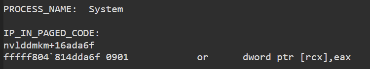

- PROCESS_NAME: `System`
  - 进程名称：`System`

  - 也就是触发这次崩溃的进程是系统进程 `System` 问题发生在内核而不是用户程序

- IP_IN_PAGED_CODE:
  - 指令指针位于可分页代码中
    - 意思是 当前出错时 CPU 正在执行的指令所在的内存页是“可分页”的

  - `nvlddmkm+16ada6f`
    - 表示出错指令位于模块`nvlddmkm`中 偏移为`0x16ada6f`

  - `fffff804`814dda6f 0901 or dword ptr [rcx],eax`
    - 出错的那条汇编指令

通过这些 我们可以知道指令所在的模块为`nvlddmkm`

我们接着往下翻`!analyze -v`的分析 试着找出这个模块对应的驱动映像文件

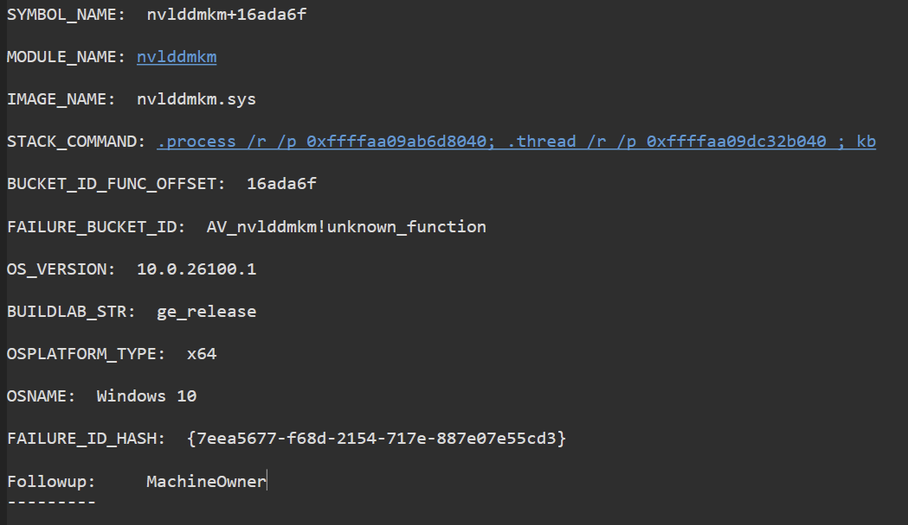

- SYMBOL_NAME:`nvlddmkm+16ada6f`
  - 符号名称：`nvlddmkm+16ada6f`

  - 表示出错位置在 `nvlddmkm` 模块内 偏移 `0x16ada6f`

  - 如果这里有完整的符号 会展示具体的函数名

- MODULE_NAME:`nvlddmkm`
  - 模块名称：`nvlddmkm`

  - 即出错的驱动模块

- IMAGE_NAME:`nvlddmkm.sys`
  - 映像名称：`nvlddmkm.sys`

- STACK_COMMAND:`.process /r /p 0xffffaa09ab6d8040`;`.thread /r /p 0xffffaa09dc32b040`;`kb`
  - 栈命令:`.process /r /p 0xffffaa09ab6d8040`;`.thread /r /p 0xffffaa09dc32b040`;`kb`

  - 这是 WinDbg 的命令 用于重现崩溃的场景
    - `.process /r /p 0xffffaa09ab6d8040`：切换到地址为 `0xffffaa09ab6d8040` 的进程上下文

    - `.thread /r /p 0xffffaa09dc32b040`：切换到地址为 `0xffffaa09dc32b040` 的线程上下文

    - `kb`：打印当前调用栈

- BUCKET_ID_FUNC_OFFSET: `16ada6f`
  - 故障桶函数偏移：`16ada6f`

- FAILURE_BUCKET_ID: `AV_nvlddmkm!unknown_function`
  - 故障桶 ID：`AV_nvlddmkm!unknown_function`
    - `AV`即`Access Violation` 表示非法访问内存

    - `nvlddmkm` 为出错模块

    - `unknown_function` 代表未知函数 因为缺少符号 无法定位到具体函数名

- OS_VERSION: `10.0.26100.1`
  - 操作系统版本：`10.0.26100.1`

  - 对应 Windows 11 24H2（内部版本 26100）

- BUILDLAB_STR: `ge_release`
  - 生成实验室字符串：`ge_release`

  - 微软内部用来标记系统编译分支的字符串 `ge_release`一般对应正式发布分支

- OSPLATFORM_TYPE: `x64`
  - 操作系统平台类型`x64` 也就是64位系统

- OSNAME: `Windows 10`
  - 操作系统名称：Windows 10

  - 这是调试器里的通用显示名 Win11也可能会被识别成Win10 以 OS_VERSION 为准

- FAILURE_ID_HASH:` {7eea5677-f68d-2154-717e-887e07e55cd3}`
  - 故障 ID 哈希：`{7eea5677-f68d-2154-717e-887e07e55cd3}`

- Followup: `MachineOwner`
  - 后续处理：`机器所有者`

  - 表示这个转储没有交给微软分析 默认由本机所有者自行处理 是普通用户机器的默认值

题目要的是执行这条异常内存访问指令的驱动映像文件

那就是 IMAGE_NAME 对应的内容 `nvlddmkm.sys`

所以答案为 `nvlddmkm.sys`

### PART 3.4 为了使故障位置不依赖本次加载时的绝对地址，请给出 faulting instruction 相对于该驱动加载基址的偏移

faulting instruction 也就是出错指令

题目要的是出错指令相对于驱动加载基址的偏移

刚刚分析过的的 IP_IN_PAGED_CODE 与 BUCKET_ID_FUNC_OFFSET 其实都给出了

这里顺带讲一下为什么要偏移 而不是Arg3给出的绝对地址

因为每次开机 绝对地址都会进行ASLR 也就是地址空间布局随机化

也就是说每次开机 绝对地址都会改变 只记绝对地址是没法正确定位到错误指令的

而偏移是固定的 只要有偏移的数据

重新开机后定位驱动加载的新地址就可以精准地定位到错误指令的位置

这道题答案为 `16ada6f`

### PART 3.5 定位 faulting component 后，还需要确认它发生在哪个进程上下文中。请提交该进程名称

faulting component 也就是故障组件

题目要求我们定位故障组件 找到它所在的进程

其实刚刚也分析到了 PROCESS_NAME 的值为`System`

也就是故障进程为`System` 所以这道题的答案为`System`

如果要更严谨地按题目的意思 通过定位的faulting component 找进程的上下文

可以用 `!process`命令 这里是`!process 0xffffaa09ab6d8040 0`

- `!process [地址 | 进程ID | 0] [详细级别]`
  - `!process` 这个命令用于查询目标系统里的进程对象

  - 第二个参数是用来定位的 `0xffffaa09ab6d8040` 就是之前定位的进程的绝对地址
    - 0 -> 所有进程

  - 第三个参数是控制回显结果的详细程度的
    - 0 -> 进程基本信息（Image、PID、目录表基址等）

    - 1 -> 加上线程列表（每个线程的栈、状态）

    - 2 -> 加上线程的详细栈信息

    - 7 -> 最详细 含有多种内部结构

我们就查个进程名 详细程度用`0` 即可

在这个小黑框里输入并执行命令

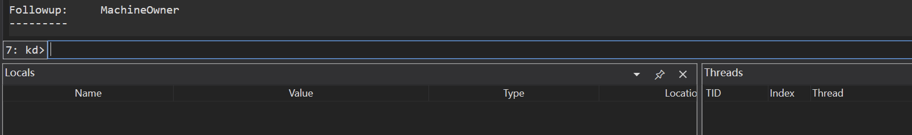

回显如下

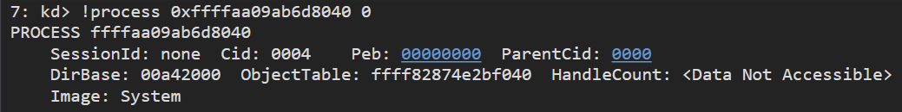

- PROCESS ffffaa09ab6d8040
  - 进程对象地址：`ffffaa09ab6d8040`

- SessionId: `none` Cid: `0004` Peb: `00000000` ParentCid: `0000`
  - SessionId: `none`
    - 会话 ID 为 none 说明它不属于任何用户登录会话（不是交互式用户进程）

  - Cid: `0004`
    - Client ID 即进程ID（PID）= 4

  - Peb: `00000000`
    - 进程环境块（PEB）地址为 0
      - System 进程没有用户态 PEB

  - ParentCid: `0000`
    - 父进程 ID = 0 说明它没有父进程

- DirBase: `00a42000` ObjectTable: `ffff82874e2bf040` HandleCount: `<Data Not Accessible>`
  - DirBase: `00a42000`
    - 页目录基址（CR3 的值）为`00a42000` 用于地址翻译

  - ObjectTable: `ffff82874e2bf040`
    - 该进程的对象句柄表地址为 `ffff82874e2bf040`

  - HandleCount: `<Data Not Accessible>`
    - 句柄计数无法访问 显示这个是因为相关内存页可能已经不可读或已损坏

- Image: `System`
  - 映像名称：`System` 即：这是System进程

总而言之 这道题答案为`System`

### PART 3.6 崩溃发生时，系统正处于什么待机状态？

题目我们需要查询崩溃发生时的系统待机状态

由于系统状态不在崩溃栈里 所以我们需要去查黑盒的内存

我们先找到`!analyze -v`给出的这块内容

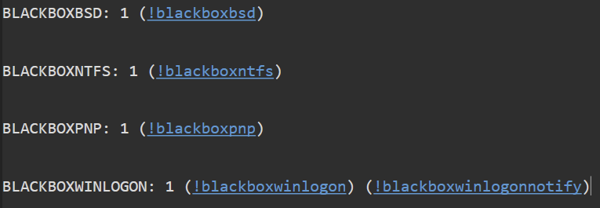

- BLACKBOXBSD: 1 (!blackboxbsd)
  - 黑盒 BSD（蓝屏数据Blue Screen Data ）：1
    - 表示转储文件里包含 BSD 黑盒信息

  - 可执行命令：`!blackboxbsd` 查看蓝屏时记录的关键状态数据

- BLACKBOXNTFS: 1 (!blackboxntfs)
  - 黑盒 NTFS（NTFS文件系统）：1
    - 表示转储文件里包含 NTFS 黑盒信息

  - 可执行命令：`!blackboxntfs` 查看崩溃时文件系统相关的状态

- BLACKBOXPNP: 1 (!blackboxpnp)
  - 黑盒 PnP（即插即用管理器Plug and Play）：1
    - 表示转储文件里包含 PnP 黑盒信息

  - 可执行命令：`!blackboxpnp` 查看崩溃时即插即用管理器相关的状态

- BLACKBOXWINLOGON: 1 (!blackboxwinlogon) (!blackboxwinlogonnotify)
  - 黑盒 Winlogon（Windows 登录进程）：1
    - 表示转储里包含 Winlogon 黑盒信息

  - 可执行命令：`!blackboxwinlogon`、`!blackboxwinlogonnotify`
    - `!blackboxwinlogon`：查看 Winlogon 进程相关状态

    - `!blackboxwinlogonnotify`：查看 Winlogon 通知事件相关状态

根据题目 我们要查系统的待机状态 是蓝屏时的状态数据

所以执行命令`!blackboxbsd` 单击高亮文本即可

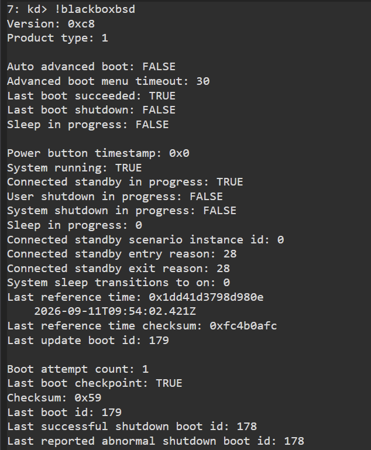

内容太多 再加上文章篇幅原因 就不像刚刚那样逐条解释了

看待机状态 我们只要抓住相关的内容即可

- Sleep in progress: `FALSE`
  - 也就是不属于传统睡眠进程（S3） 那就接着看

- Connected standby in progress: `TRUE`
  - 也就是连接待机正在进行 那么这个就是崩溃时的待机状态

所以这道题的答案为`connectedstandby`

### PART 3.7 最后一次电源状态参考记录距离系统崩溃相差多少毫秒？

电源状态也是状态 还是看刚刚`!blackboxbsd`的内容

看`Last reference time` 即崩溃前最后一次记录的时间参考点

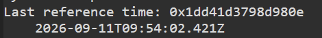

可以得到时间为 `2026-09-11T09:54:02.421Z`

题目要求我们找与崩溃时间的差值 所以我们还需要确定崩溃时间

利用命令 `.time` 即可快速获取崩溃时间

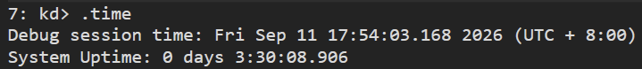

当然 你要是不嫌麻烦 也可以在 刚加载dmp文件时的预加载日志里查找

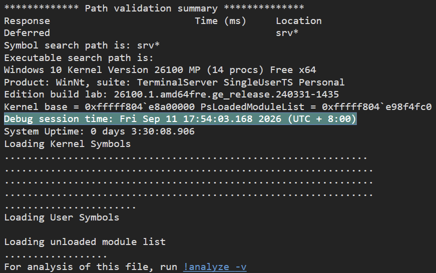

记得要做时区修正 这里选择调崩溃时间（即减去8小时）

总之获得崩溃时间为 `2026-9-11T09:54:03.168Z`

崩溃时间 - 最后一次电源状态参考记录时间 = 747毫秒

所以这道题的答案为747

### PART 3.8 综合内存转储文件中的各条线索，下列哪一个结论是目前能够作出的最严谨判断？

- A. Windows 内核自身缺陷，与第三方驱动无关。

- B. Hyper-V 是此次蓝屏的根本原因。

- C. 现有证据可以定位直接故障点并还原部分崩溃现场，但不足以唯一确定更深层的根本原因。

- D. 可以确定用户进行了拔电操作，该操作直接导致 NVIDIA 驱动崩溃。

选择题 我们一个一个看

- A选项
  - faulting instruction 的归属模块是 `nvlddmkm.sys`

  - 这是第三方驱动（NVIDIA显卡驱动）不是 Windows 内核组件

  - 所以A选项错误

- B选项
  - 虽然可以查询到Hyper-V的信息 但不代表是它的问题

  - 崩溃发生在NVIDIA显卡驱动 所以根因定位到Hyper-V并不合适

  - 所以B选项错误

- C选项
  - 根据刚刚的分析 我们确实定位到了故障地址 并且还原了部分崩溃现场

  - 我们也只能简单的确定蓝屏位置是NVIDIA显卡驱动 没有定位到根因

  - 所以C选项正确

- D选项
  - 直接看刚刚`!blackboxbsd`的分析结果

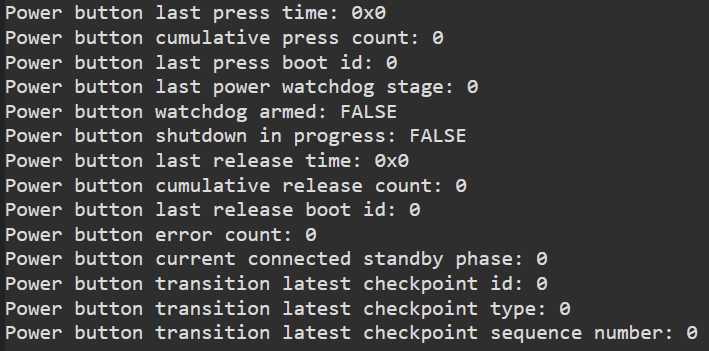

    - Power button last press time: `0x0`

    - 电源按钮最后一次按下的时间显示0 也就是说电源按钮从未被按下过

    - 所以D选项错误

所以这道题的答案为 `C`
