# HDCTF Misc

## **MISC**

### **Welcome**

**题目描述**：快乐签到题

关注"HnuSec"微信公众号，后台发送"签到"

领取你的第一个flag吧^\_^

**工具**：Cyberchef

签到题 找微信公众号发“签到”两个字就行

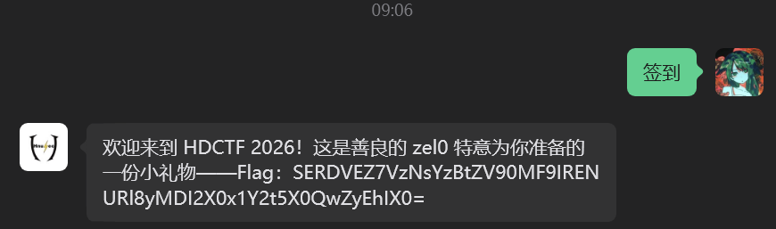

base64 拿去 **Cyberchef** 解密

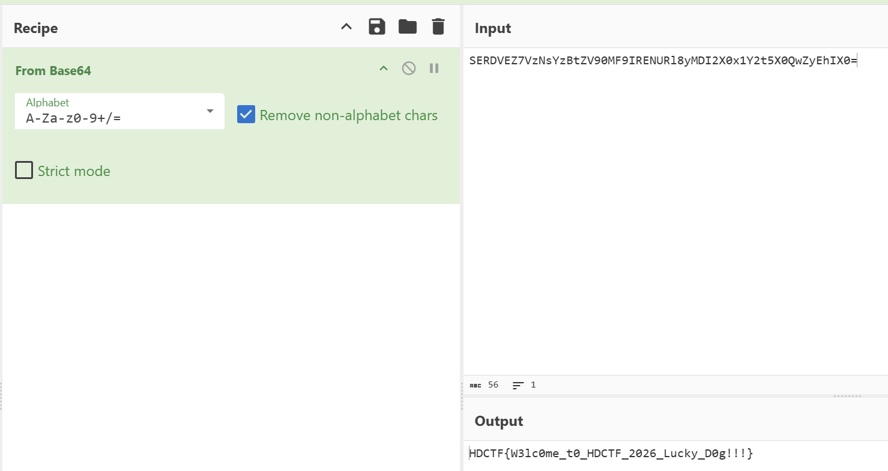

取得flag flag为

`HDCTF{W3lc0me_t0_HDCTF_2026_Lucky_D0g!!!}`

### **真的懂word吗**

**题目描述**：这是一篇有关 HnuSec 战队的内部介绍文档，听说有战队成员在里面埋了一个隐藏彩蛋，找到它的人可以直接获得面试加分（假的，但Flag是真的）。

顺便一提，这位成员最近迷上了“拿来主义”，不过借来的东西，总得留个署名。

**工具**：exiftool

拿到附件 docx文件


刚开始猜测全选文本 发现文本没东西

word文件本质上是压缩包 改后缀为zip 解压看内容

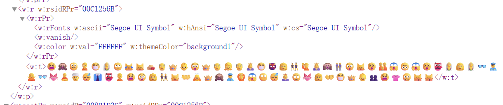

发现emoji 刚开始猜测base100 发现解出来乱码

根据题目描述 有个署名 查exif 用 **exiftool**

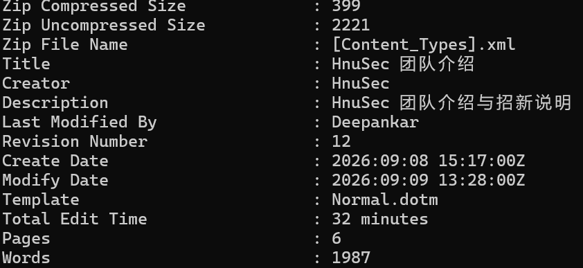

发现有个人名Deepankar 通过搜索 发现他是Txtmoji这种编码的创始人

找到[在线网址](https://txtmoji.com/)

解密emoji需要密码 没有找到明晃晃的文本 得靠猜

猜测密码HnuSec 因为它在Creator显示了 而一般这里都是空的

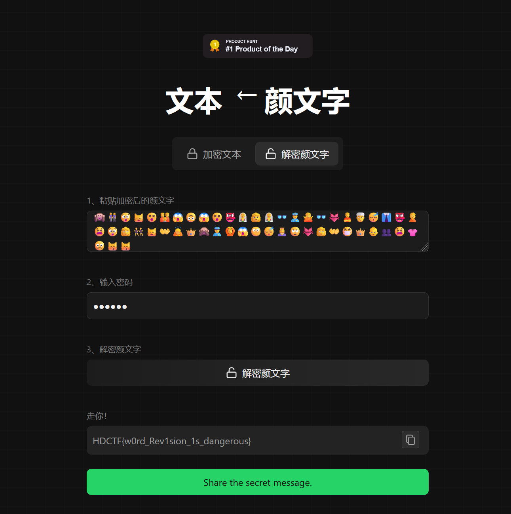

取得flag flag为

`HDCTF{w0rd_Rev1sion_1s_dangerous}`

### **雾都的秘密**

**题目描述**：审计系统发现，一台内网主机在雾都的深夜产生了异常的 ping 与 DNS 流量。

值班人员只来得及保存这份抓包：secret.pcapng。

请还原被传出的内容，并提交其中的 flag。

**工具**：Wireshark tshark python

拿到附件 pcapng文件


**Wireshark** 打开

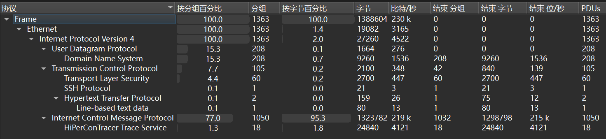

发现只有少量http和tcp协议 大部分是icmp协议 还有些udp和dns

过滤http流 发现notice.txt 追踪http流

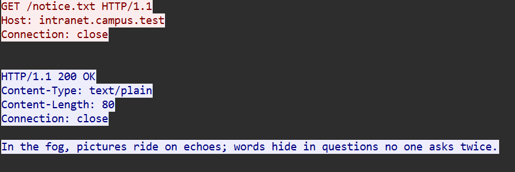

得到hint 图片藏在 ICMP echo 里 文字藏在"只被问一次"的 DNS 查询里

利用 **tshark** 对DNS全量枚举

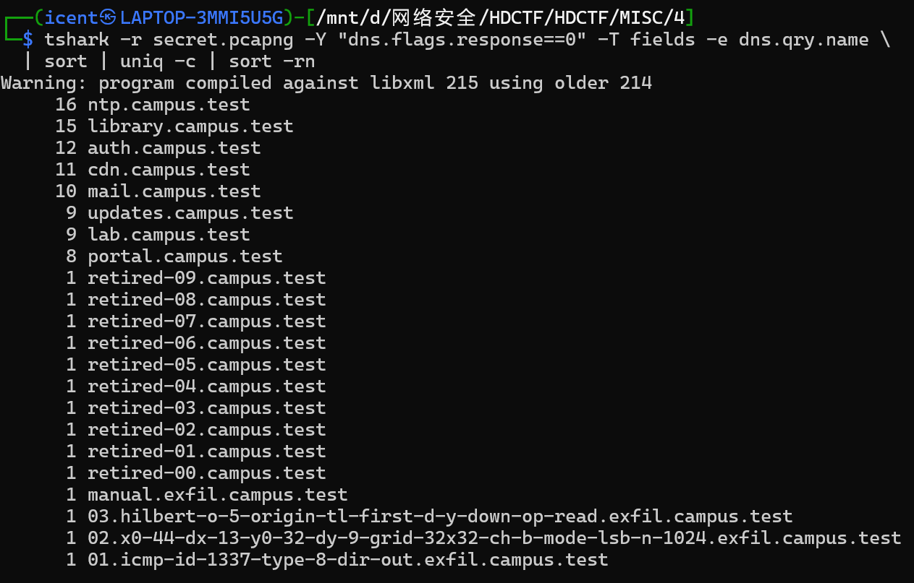

发现14个 然后因为"exfil" 就是 exfiltration（数据外泄）的缩写 所以选择先看这个


汇总一下得到的信息

数据在 ICMP

id1337是十六进制（=4919）

type=8 请求 出向

32×32 网格 起点 (44,32) 步长 (13,9) 蓝色通道LSB

Hilbert 曲线 5 阶 左上原点

分包总数与最终长度 校验值 可用来验证重组是否正确

二级载荷结构

位序是 MSB-first

CRC16-CCITT poly 0x1021 init 0xFFFF，大端

现在需要 ICMP 重组 用 **tshark** 提取

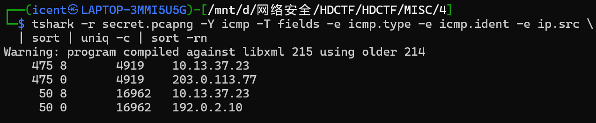

4949 取前两个 然后 载荷开头有个自定义头 是20字节

取475个分片 去掉前20字节 合并获取图片

> 注意这里9个包的载荷被误判成hipercontracer协议了
>
> 要加` --disable-protocol hipercontracer`

```Python
import subprocess, zlib

out = subprocess.run(
    'tshark -r secret.pcapng --disable-protocol hipercontracer '
    '-Y "icmp.ident==0x1337 && icmp.type==8" -T fields -e icmp.seq -e data.data',
    shell=True, capture_output=True, text=True).stdout

rows = []
for line in out.splitlines():
    if not line.strip():
        continue
    raw = bytes.fromhex(line.split("\t")[1])
    seq, body = int.from_bytes(raw[8:10], "big"), raw[20:]
    assert raw[:4] == b"IGPK"
    assert zlib.crc32(body) & 0xFFFFFFFF == int.from_bytes(raw[16:20], "big")
    rows.append((seq, body))

data = b"".join(b for _, b in sorted(rows))
png = data[:data.index(b"IEND") + 8]
open("hidden.png", "wb").write(png)
print(f"{len(rows)} 分片 {len(data)} 字节 -> hidden.png {len(png)} 字节")
```

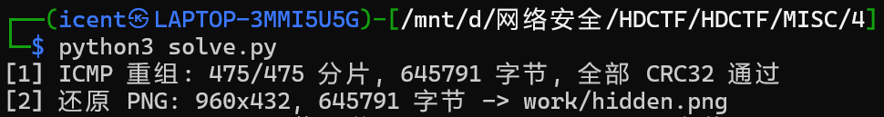

得到


根据刚刚的信息 看MSB 还要用Hilbert 曲线5阶

```Python
import numpy as np
from PIL import Image
a = np.array(Image.open("hidden.png").convert("RGB"))

def d2xy(n, d):
    x = y = 0; t, s = d, 1
    while s < n:
        rx = 1 & (t >> 1); ry = 1 & (t ^ rx)
        if ry == 0:
            if rx == 1: x, y = s-1-x, s-1-y
            x, y = y, x
        x += s*rx; y += s*ry; t >>= 2; s <<= 1
    return x, y

pts  = [d2xy(32, d) for d in range(1024)]
bits = [int(a[32 + 9*gy, 44 + 13*gx, 2]) & 1 for gx, gy in pts]
out  = bytearray()
for i in range(0, 1024, 8):
    v = 0
    for b in bits[i:i+8]: v = (v << 1) | b
    out.append(v)

print(out.decode('latin1'))
```

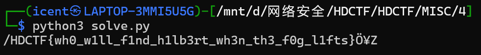

取得flag flag为

`HDCTF{wh0_w1ll_f1nd_h1lb3rt_wh3n_th3_f0g_l1fts}`

### **自定义**

**题目描述**：有人把音乐做成了自己的样子，也把文件做成了自己的样子

**工具**：010 Editor Cyberchef sqlitebrowser

这个题目流程很长 所以加了很多小标题

拿到附件，十个文件


这些文件名是许嵩的歌名 先看自定义.vae吧 没见过这个后缀名 **010Editor** 打开

#### 浅看 自定义.vae


文件名魔数`VAEMUSIC` 还发现这里有明文json

010里有乱码 提出来看看

```JSON
{
  "title": "多余的解释",
  "format": "wav",
  "track": 2,
  "indexed_chunks": [
    {
      "type": 2,
      "name": "多余的解释.wav"
    }
  ]
}
```

发现这里可能藏了wav音频 不过目前还不知道怎么解出来

看下许蒿的专辑 发现这个文件的歌名序列是乱的 正确顺序是这样的

```Markdown
1. 如果当时
2. 多余的解释
3. 有何不可
4. 坏孩子
5. 清明雨上
6. 城府
7. 认错
8. 内线
9. 星座书上
```

猜测仿照的ISCC的卜肆残局 每个附件提取一部分内容 然后合起来base64

#### 如果当时.jpg


发现2009年的1-9日都被划了 如果单日日期 那可能是 20090110

010打开


发现exif有内容 VAEFRAG是base64

而且日期确实如我们猜想 是 20090110

取得第一段

VkFFMXxMRXxEQVRFPTIwMDkwMTEwf

#### 多余的解释.txt


叽里咕噜说啥呢

取得第二段

EtERj1TSEEyNTYoVkFFTVVTSUN8fE

#### 有何不可.bin

010打开


看起来是乱码 过根据文件名 “不可” 可以联想NOT非运算

使用 **Cyberchef**


得到可读内容

取得第三段

RBVEUpfEtFWT1OT1Q+QUVTMTI4RUN

#### 坏孩子.json


发现id3有个base64 `TdUQMZELFxkNxUEUZRVPL5UVINEfC` 而且提示让reverse


取得第四段

CfENIVU5LPVRZUEUxNkxFLEZMQUdT

#### 清明雨上.wav

先听一下 发现听起来没什么 010打开


句末发现有内容 是VAEFRAG

取得第五段

MTZMRSxMRU4zMkxFLENSQzMyfENL

#### 城府.zip

解压后得到100个chunk


发现zip头 说明chunk应该需要通过某种方式合起来得到新的zip

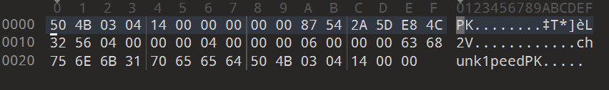

检查了一会 发现100个chunk字节上是连续的 只需要拼接即可 得到新的压缩包后再次解压


这次是50个chunk 010接着读 发现好像在循环字符串 repeed 逆序是 deeper 直觉告诉我xor

那这里就先拼接 再逆序 再xor deeper


得到新压缩包 解压


发现要密码 经过尝试发现是伪加密 010手动修复


解压得到 fragment.dat 010打开


得到 VAEFRAG

取得第六段

RVk9U0hBMjU2KFNFRUR8fFRZUEUX

#### 认错.log


发现一堆base64

可以直接暴力点 都扔进Cyberchef 哪个解出内容哪个就是我们要的


发现有条解出了可读字符 一条条检验一下


取得第七段

NkxFfHxMRU4zMkxFKXxLU0E9U0VF

#### 内线.idx

010打开


发现有一段文本

```
IDX8P9F]Y^B\nMF[Yr9Y\MNB\fp]ELA1INNER/1
byte -> divmod(36) -> two symbols
symbol -> matrix(row,col)
block = 36 symbols
transform = all rows, then all columns, repack by coordinate pairs
the alphabet is not stored here

```

一种解密方式 提供了一个操作步骤


但是它又说 `the alphabet is not stored here` 表明字符表不在这里

猜测这个信息可能后面才会用 先留着

这里有文件魔数 IDX 想了很久 最后发现魔数后面跟的 8 是线索 最后试出来是xor


可以看到得到了一段形似base64的明文 解base64检验一下 确实是我们要的内容


取得第八段

X1NUQVJTfENSQz1QTEFJTnxUMDI9AFFMZ

#### 星座书上.db

db文件 **sqlitebrowser **打开


发现有两个表 先查第一个constellations


发现没什么内容 查第二个表pages


直译十二登录说是 然后给了段文本


星星的顺序不是文件的顺序

然后另一个直译是256页

得到一个算法KSA

```Plain Text
KSA:
S=0..255;
j=(j+S[i]+K[i%32])&255;
swap(S[i],S[j]).

STREAM:
a=n&255;
b=S[(a+S[a])&255];
c=S[(S[a^0x5A]+b)&255];
out=S[(a+b+c)&255].
```

还得到了fragment

取得第九段

SU5ERVhFRHxUMDg9VU5JTkRFWEVE

#### 第一轮总结

先理一下目前得到了什么

9段base64

```Plain Text
1 VkFFMXxMRXxEQVRFPTIwMDkwMTEwf
2 EtERj1TSEEyNTYoVkFFTVVTSUN8fE
3 RBVEUpfEtFWT1OT1Q+QUVTMTI4RUN
4 CfENIVU5LPVRZUEUxNkxFLEZMQUdT
5 MTZMRSxMRU4zMkxFLENSQzMyfENL
6 RVk9U0hBMjU2KFNFRUR8fFRZUEUx
7 NkxFfHxMRU4zMkxFKXxLU0E9U0VF
8 X1NUQVJTfENSQz1QTEFJTnxUMDI9
9 SU5ERVhFRHxUMDg9VU5JTkRFWEVE
```

自定义.vae中得到的json


如果当时.jpg中得到的日期


内线.idx中得到的操作步骤


星座书上.db中得到KSA算法与文本


这里星星的顺序不是文件的顺序 应该是指我们开头就做过的专辑歌名排序

但这里有一个点让人在意 这里说的是12 但我们只有10个文件

可能意味着我们需要通过现有的材料再解出两个新文件

这和我们开始分析的vae里面可能藏了wav音频这一点对上了

那么不难确定 我们下一个方向应该就是研究 自定义\.vae

先按照顺序 解密我们得到的9段base64


得到

```Plain Text
VAE1|LE|DATE=20090110|KDF=SHA256(VAEMUSIC||DATE)|KEY=NOT>AES128ECB|CHUNK=TYPE16LE,FLAGS16LE,LEN32LE,CRC32|CKEY=SHA256(SEED||TYPE16LE||LEN32LE)|KSA=SEE_STARS|CRC=PLAIN|T02=INDEXED|T08=UNINDEXED
```

VAE1\|LE -> 小端序

DATE=20090110 -> DATE为20090110

KDF=SHA256(VAEMUSIC||DATE) -> 可解KDF

KEY=NOT>AES128ECB -> 可解KEY

CHUNK=TYPE16LE,FLAGS16LE,LEN32LE,CRC32 -> Chunk Header

CKEY=SHA256(SEED||TYPE16LE||LEN32LE) -> 每个CHUNK都给一个CKEY

KSA=SEE_STARS -> 提示KSA的算法去看星星 也就是 星座书上.db 拿到的算法

CRC=PLAIN -> CRC校验数据

T02=INDEXED -> Type02被索引

T08=UNINDEXED -> Type08 没有被索引 那可能这里藏了数据

#### 解析 自定义.vae 头

通过🔨出题人 得到vae文件的结构（卡壳很久 没办法了）

```C++
struct VAEHeader {
    char     magic[8];        // VAEMUSIC
    uint8_t  version;         // 1
    uint8_t  flags;           // 1
    uint16_t header_size;     // 32
    uint32_t key_size;        // 48
    uint32_t meta_size;       // 111
    uint32_t chunk_count;     // 1
    uint32_t data_offset;     // 191
    uint32_t header_crc32;    // 0x1a3547f0
};
```

由此 我们知道vae文件中 有keyblock(size48)和metadata(size32)

而且发现metadata就是我们先前发现的json

```JSON
{
  "title": "多余的解释",
  "format": "wav",
  "track": 2,
  "indexed_chunks": [
    {
      "type": 2,
      "name": "多余的解释.wav"
    }
  ]
}
```

这里的json对应的就是 `T02=INDEXED` 对应的文件是 多余的解释\.wav
那我们还差一个 `T08=UNINDEXED` 这里应该也能解出文件 这样就是12个文件了

#### 解密 KeyBlock

说明书给了方法 `KDF=SHA256(VAEMUSIC||DATE)` 和 `KEY=NOT>AES128ECB`

然后我们还知道了keyblock 这里就可以解SEED

```Python
import hashlib
from cryptography.hazmat.primitives.ciphers import Cipher, algorithms, modes

# 日期来自「如果当时.jpg」的日历：2009 年 1 月，1-9 日划掉，10 日保留
master = hashlib.sha256(b"VAEMUSIC" + b"20090110").digest()
print(master.hex())


# KeyBlock 先整体 NOT，再用 master 前 16 字节做 AES-128-ECB 解密
dec = Cipher(algorithms.AES(master[:16]), modes.ECB()).decryptor()
pt = dec.update(bytes(~b & 0xFF for b in keyblock)) + dec.finalize()

print(pt[:7])
seed = pt[7:-pt[-1]]   # 去掉尾部 PKCS#7 填充（尾部 9 个 0x09）
print(seed.hex())
```


#### 解出 CKEY

根据 `CHUNK=TYPE16LE,FLAGS16LE,LEN32LE,CRC32` 可以知道CHUNK的结构

```C++
struct VAEChunk {
    uint16_t type;
    uint16_t flags;
    uint32_t length;
    uint32_t crc32;
};
```

提取需要解密的两个chunk(0x02和0x08)

```Python
import struct
d = open("自定义.vae", "rb").read()

pos = struct.unpack_from("<I", d, 24)[0]        # data_offset = 191
while pos + 12 <= len(d):
    typ, fl, n, crc = struct.unpack_from("<HHII", d, pos)
    if not (0 < n <= len(d) - pos - 12):
        break
    print(f"type=0x{typ:02X} flags={fl} len={n} crc=0x{crc:08X} @{pos}")
    pos += 12 + n
```


由 `CKEY=SHA256(SEED||TYPE16LE||LEN32LE)` 和刚刚解KeyBlock得到的SEED 就可以求CKEY

```Python
import hashlib

seed = bytes.fromhex("13fa58afb99a4d3a0bfe946e3ca9ec17791b3a7409aeffa3a7b6bdfb9bb6785c")

for typ, n in [(0x02, 7938220), (0x08, 15876116)]:
    ckey = hashlib.sha256(seed + typ.to_bytes(2, "little") + n.to_bytes(4, "little")).digest()
    print(f"0x{typ:02X}  ckey = {ckey.hex()}")
```


#### 解出剩下的两个文件

用 星座书上.db 提供的算法

```Python
def build_keystream(chunk_key):
    # KSA: S=0..255; j=(j+S[i]+K[i%32])&255; swap(S[i],S[j])
    S = list(range(256))
    j = 0
    for i in range(256):
        j = (j + S[i] + chunk_key[i % 32]) & 255
        S[i], S[j] = S[j], S[i]

    # STREAM: a=n&255; b=S[(a+S[a])&255]; c=S[(S[a^0x5A]+b)&255]; out=S[(a+b+c)&255]
    per = bytearray(256)
    for n in range(256):
        a = n & 255
        b = S[(a + S[a]) & 255]
        c = S[(S[a ^ 0x5A] + b) & 255]
        per[n] = S[(a + b + c) & 255]
    return bytes(per)
```

KSA和STREAM解密 并通过crc和输出前12个字节校验内容

```Python
enc = d[pos + 12 : pos + 12 + n]
plain = bytes(x ^ y for x, y in zip(enc, (per * (n // 256 + 2))[:n]))
ok = (zlib.crc32(plain) & 0xFFFFFFFF) == crc

print(f"0x{typ:02X} len={n:9d} crc {'OK' if ok else 'BAD'} head={plain[:12]!r}")
if ok:
    Path(f"chunk_{typ:02X}.bin").write_bytes(plain)
pos += 12 + n
```


发现 `RIFF` 说明我们解对了 解出了wav音频
还发现了 `INNERDAT` 这下12个文件齐全了

提取出来


010看看


内线.dat有点迷了 暂时先不看 先看wav

#### 多余的解释.wav

010发现文件末尾有内容


```Plain Text
fLaG
HDCTF{th1s_3xpl4n4t10n_1s_r3dund4nt_k33p_l00k1ng}
JUNK
Nothing useful here. Keep looking.
map6
AM09nz66
stg1
0800000001018900D9070000
```

这个flag是fakeflag 和 junk 都是再说接着找
map6这个有点眼熟的 很像ISCC2026的扭曲的真相

AM09nz66 实际上是字符表 A-M 0-9 n-z

至于66 猜测是6x6矩阵 因为对于第一轮获得的内容 我们就剩内线.idx的内容没有用了


字符表就是 ABCDEFGHIJKLM0123456789nopqrstuvwxyz

映射矩阵就是

```Plain Text
A B C D E F
G H I J K L
M 0 1 2 3 4
5 6 7 8 9 n
o p q r s t
u v w x y z
```

#### 解出 内线.wav

```Python
import struct, sys
from pathlib import Path

src, dst = Path(sys.argv[1]), Path(sys.argv[2])

ALPHABET = "ABCDEFGHIJKLM0123456789nopqrstuvwxyz"      # AM09nz66
POS = {c: i for i, c in enumerate(ALPHABET)}

def inverse_block(s):                 # 36 个 symbol
    nums = []
    for ch in s:
        v = POS[ch]
        nums += [v // 6, v % 6]       # symbol -> matrix(row,col)
    rows, cols = nums[:36], nums[36:]  # 前半 row[]，后半 col[]
    return "".join(ALPHABET[rows[i] * 6 + cols[i]] for i in range(36))

raw = src.read_bytes()
body = raw[28:].decode("latin1")      # 跳过 28 字节 INNERDAT 头

sym = "".join(inverse_block(body[i:i+36]) for i in range(0, len(body) // 36 * 36, 36))

out = bytearray()
for i in range(0, len(sym) - 1, 2):
    out.append(POS[sym[i]] * 36 + POS[sym[i+1]])

wav = bytes(out)
assert wav[:4] == b"RIFF" and wav[8:12] == b"WAVE"
dst.write_bytes(wav)
print(f"{len(wav)} 字节 → {dst}")
```

得到内线.wav


#### 内线.wav 音频隐写

多余的解释.wav 得到的内容只剩stg1没看懂是要干什么了

🔨出题人 得到stg1的结构

```C++
struct {
    uint8_t  channel;     // 1
    uint8_t  bit_order;   // 1
    uint16_t step;        // 137
    uint32_t start;       // 2009
};
```

看起来是音频隐写的指示

右声道
start frame = 2009
每隔 137 frame 取一个 bit
MSB-first 组装 byte

```Python
import io, struct, wave
from pathlib import Path

with wave.open("内线.wav", "rb") as f:
    frames = f.getnframes()
    raw = f.readframes(frames)
samples = struct.unpack("<" + "h" * (len(raw) // 2), raw)

n_bits = (frames - 2009 + 136) // 137
n_bytes = n_bits // 8

bits = [samples[(2009 + i * 137) * 2 + 1] & 1 for i in range(n_bits)]
out = bytes(sum(bits[i*8 + j] << (7 - j) for j in range(8)) for i in range(n_bytes))

print(out)
```


取得flag flag为

`HDCTF{th3_1nn3r_l1n3_w4s_n3v3r_1n_th3_m3t4d4t4_233a8358}`
